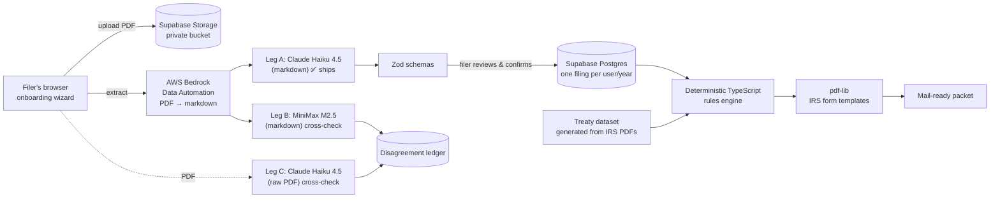

# TaxBuddy

**U.S. tax filing for international students and other nonresident aliens.**

🌐 **Live at [filetaxbuddy.com](https://www.filetaxbuddy.com)** · 🎬 **[Watch the demo](https://drive.google.com/file/d/1gByHJFeFgyq_C80Fv_QmVOdyDkXUcm43/view?usp=sharing)**

TaxBuddy turns a stack of tax documents (W-2, 1042-S, 1099s, I-20, I-94) into a complete,
mail-ready **Form 1040-NR** return. That includes the residency test, tax-treaty benefits and
every supporting schedule.

---

## Why the source code is private

This repository is a public overview. The application code lives in a private repository, for
these reasons:

- **It handles sensitive personal data.** Filers upload documents with SSNs/ITINs, wages,
  immigration records and bank details. The codebase includes security controls, an internal
  Written Information Security Plan (WISP) and infrastructure configuration that should not be
  published.
- **Tax-preparer compliance.** TaxBuddy collects IRS §7216 consent and runs as a gated pilot.
  Keeping the implementation private reduces the attack surface of a live product holding real
  filer data.
- **It's an active product.** The extraction pipeline, the treaty dataset and the rules engine
  took months of iteration and benchmarking to build.

I'm happy to walk through the code in an interview or a screen share.

---

## The problem

Mainstream tax software assumes you're a U.S. resident. Most international students on F-1/J-1
visas are **nonresident aliens** for tax purposes. They need a different return (1040-NR),
the _substantial presence test_, the _exempt-individual_ rules (Form 8843) and, often, a **tax
treaty** with their home country that exempts part of their income. Getting this wrong is
common and expensive: students file the wrong form, miss treaty benefits, or overpay FICA they
were never supposed to owe.

## What it does

```
sign up → answer eligibility questions + upload I-94 / I-20
        → confirm what was read off those documents
        → short interview + upload income documents (W-2, 1042-S, 1099s)
        → profile (name, SSN/ITIN, addresses)
        → see your refund or amount owed, choose how to get paid
        → download a mail-ready PDF packet: print, sign, mail
```

- **Forms generated:** 1040-NR, Schedule 1, Schedule NEC, Schedule OI, Schedule A, Form 8833
  (treaty position), Form 8843, a capital-gains continuation statement, and a one-page
  "what to do after you print this" cover sheet.
- **Documents understood:** W-2, 1042-S, 1099-INT, 1099-DIV, 1099-B, 1099-DA (crypto),
  consolidated brokerage 1099s, I-20, I-94.
- **Tax treaties:** all 199 countries are catalogued against the IRS treaty tables, and
  benefits are live for **56** of them.
- **Refund Check:** a free, no-signup funnel that gives an instant refund estimate from
  uploaded documents.
- **Admin & audit:** a per-filing audit trail that traces every number on every form back to
  its source document and rule.

---

## Current status

- 🟢 **Live pilot** for the **2025 tax year** at [filetaxbuddy.com](https://www.filetaxbuddy.com),
  with a limited number of filers and a pilot waiver at sign-up.
- 📬 **Paper filing only.** TaxBuddy produces a complete, ready-to-sign packet with the
  filer's W-2/1042-S copies attached in the order the IRS expects. E-file is not supported.
- 🔍 **Extraction disagreements are logged** and reviewed. The ledger shows which fields need
  a filer-facing confirmation screen, which is the next major feature.
- 🧭 **Up next:** the confirm UI for fields the models disagree on, more countries promoted to
  live treaty benefits, and support for multiple treaty positions on Form 8833.

---

## Architecture (high level)



**Stack:** Next.js 16 (App Router) · React 19 · TypeScript · Tailwind v4 · shadcn on Base UI ·
Supabase (Auth, Postgres with row-level security, Storage) · AWS Bedrock + Bedrock Data
Automation · Zod · react-hook-form · pdf-lib · motion · Vitest

### Key architectural decisions

**1. Split brain: the AI reads, TypeScript calculates.**
LLMs only turn documents into strings. Every tax number (brackets, treaty caps, withholding,
capital gains, the refund itself) is computed by deterministic, golden-tested TypeScript.
Returns are reproducible and auditable, and a model can never invent a number on a tax form.

**2. Extract, then confirm.**
Extraction endpoints have no side effects: they return data and save nothing. Data reaches
the database only after the filer has reviewed it on screen. The user stays in the loop, and
retries are always safe.

**3. Read every document three times, with paths that fail in different ways.**
Leg A (Haiku on parsed markdown) is the answer that ships. Leg B (a different model on the
same markdown) catches _model_ misreads. Leg C (Haiku on the raw PDF) catches content the
_parser_ dropped. The parser + raw-PDF pairing was chosen because the two fail differently:
on the benchmark set it needed zero filer interruptions and let zero errors through.
Cross-checks run after the response is sent, so they add no latency, and disagreements go to
a ledger. For brokerage statements, the extracted rows are also checked against the
document's own printed totals.

**4. Model choice by benchmark, not by reputation.**
Six models were scored on tax-line fields only. Claude Haiku 4.5 made **zero errors that
change a tax number** across 808 fields, and when it was unsure it returned "unknown" with
zero confidence instead of guessing. A cheaper model is the cross-check, so its occasional
misses are caught rather than shipped.

**5. Wizard steps ordered by parse cost, not by topic.**
Every step that uploads a document is followed by a step of questions that don't depend on
it, so the slow parse runs while the filer types. When they reach the payout screen, the
numbers are already computed.

**6. Treaty data is generated from IRS sources, with a human in the loop.**
Treaty rules are generated by scripts from the IRS treaty tables and verified against the
source cells by machine. A country only grants benefits after a human has reviewed its
treaty block, so an unreviewed country behaves exactly like one with no treaty. A missed
benefit can be fixed later; a wrongly claimed one cannot.

**7. One rules engine, one source of truth.**
The income engine runs once per request. Every form, the payout screen and the Refund Check
read from that single result, so different screens can't disagree about a number. Generated
packets are cached by a hash of their inputs.

**8. Privacy by narrowing the processor list.**
Filer documents go only to AWS (Bedrock) and Supabase. Row-level security keeps each user to
their own data, uploads sit in a private bucket, and nothing is collected without §7216
consent.

### Quality & testing

- **Golden tests** for the rules engine, per-form math, treaty data and the audit graph
- **A synthetic-filer harness** that runs 10 fake filers through the real pipeline end to end
- **An invariant checker** that flags "you changed X, so you also have to change Y" against
  the working diff
- **A treaty verifier** that diffs every treaty value against the IRS source tables

---

_Built by George Evans Daenuwy · [filetaxbuddy.com](https://www.filetaxbuddy.com)_
